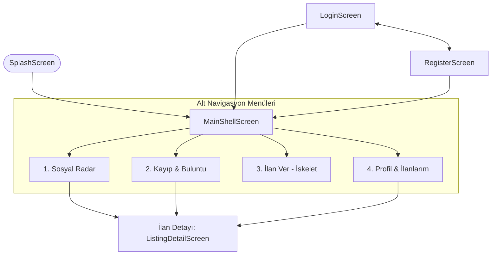

# Hafta 1 — Berke Mahmut Acar: Flutter Mobil İskeleti

Dönem projesi plan belgesindeki 1. Hafta görev dağılımı uyarınca, **fixCampus** Flutter mobil uygulamasının temel proje iskeleti, Android yapılandırması, minimalist siyah-beyaz tasarım sistemi ve mobil menü/ekran akışları geliştirilmiştir.

Uygulama, Berna Kalkan'ın hazırladığı `lib/models` altındaki 6 veri modeliyle uyumlu kurgulanmış; Zülfikar Durak'ın geliştireceği ortak API servis katmanı için `lib/core/network` altyapısı hazır hale getirilmiştir.

---

## 1. Tasarım ve Sadeleştirme Kararları (Hafta 1)

1. **Minimalist & Siyah Renk Paleti**: Ağır ve kalabalık renkler yerine siyah, beyaz ve nötr gri tonlardan oluşan sade bir arayüz benimsenmiştir.
2. **Logosuz, Hafif Üst Başlık**: Ekranlarda yer kaplayan ağır logolar kaldırılmış, sade tipografik başlık (`fixCampus`) kullanılmıştır.
3. **Menü Geçişleri**: Alt navigasyon çubuğu üzerinden 4 ana menü (**Radar**, **Kayıp-Buluntu**, **İlan Ver**, **Profil**) arasında kesintisiz geçiş sağlanmıştır.
4. **İskelet Kapsamı (Statik / Pasif Eylemler)**: 1. haftanın kapsamı proje iskeleti ve ekran akışları olduğundan; fotoğraf yükleme, saat/tarih seçme fonksiyonları ve form gönderimi kaldırılmış, temel metin alanlarından oluşan sade bir taslak bırakılmıştır.
5. **Yönetici Paneli**: Kullanıcı arayüzünü sade tutmak amacıyla yönetici/öğrenci geçiş butonları ana kabuktan kaldırılmış, temel öğrenci akışına odaklanılmıştır.
6. **Telefon Görünümü (Android Frame)**: Masaüstü tarayıcısında yayılmayı önlemek ve gerçek mobil cihaz boyutunda inceleme yapabilmek için 412x870 Android telefon çerçevesi ve bağımsız mobil pencere desteği entegre edilmiştir.

---

## 2. Proje Yapısı ve Dizin Hiyerarşisi

```text
lib/
├── core/                         # Ortak çekirdek yapılar
│   ├── constants/
│   │   ├── api_endpoints.dart    # Web API uç noktaları (/api/ilanlar, /api/durum vb.)
│   │   └── app_constants.dart    # Temel uygulama ve bağlantı sabitleri
│   └── network/
│       └── api_client.dart       # Dio tabanlı HTTP istemcisi ve token interceptor iskeleti
├── models/                       # Berna Kalkan tarafından hazırlanan 6 Dart veri modeli
│   ├── ilan.dart
│   ├── ilan_fotografi.dart
│   ├── json_fields.dart
│   ├── kategori.dart
│   ├── katilim.dart
│   ├── model_enums.dart
│   ├── models.dart
│   ├── profil.dart
│   └── sikayet.dart
├── providers/                    # State management (Provider) katmanı
│   ├── auth_provider.dart        # Oturum ve profil durumu
│   └── listings_provider.dart    # İlanlar, kategoriler ve liste durumu
├── routes/
│   └── app_routes.dart           # Rota adları ve onGenerateRoute navigasyon yöneticisi
├── screens/                      # Kullanıcı arayüzü ekranları
│   ├── admin/
│   │   └── admin_panel_screen.dart       # Yönetici şikâyet ve kategori denetim taslağı
│   ├── auth/
│   │   ├── login_screen.dart             # Sadeleştirilmiş giriş ekranı
│   │   └── register_screen.dart          # Sadeleştirilmiş kayıt ekranı
│   ├── listings/
│   │   ├── create_listing_screen.dart    # İlan verme formu iskeleti (tür ve alanlar)
│   │   └── listing_detail_screen.dart    # İlan detay ve bilgi görünümü
│   ├── lost_found/
│   │   └── lost_found_feed_screen.dart   # Kayıp-Buluntu sekmesi (Kayıp/Buluntu filtreleri)
│   ├── profile/
│   │   └── profile_screen.dart           # Profil bilgileri ve "İlanlarım" listesi
│   ├── radar/
│   │   └── radar_feed_screen.dart        # Sosyal Radar akışı ve kategori filtreleme
│   ├── shell/
│   │   └── main_shell_screen.dart        # 4 sekmeli minimalist ana kabuk
│   └── splash/
│       └── splash_screen.dart            # Minimalist açılış ve yönlendirme ekranı
├── theme/
│   └── app_theme.dart            # Siyah & beyaz minimalist tema
├── widgets/                      # Yeniden kullanılabilir UI bileşenleri
│   ├── app_button.dart           # Siyah minimalist butonlar
│   ├── category_chip.dart        # Sade kategori filtre çipleri
│   ├── empty_state.dart          # Boş liste durumu tasarımı
│   ├── listing_card.dart         # Minimalist ilan kartı
│   └── status_badge.dart         # Sade tür ve durum rozetleri
└── main.dart                     # MultiProvider, yerelleştirme ve MaterialApp giriş noktası
```

---

## 3. Ekran Akış Şeması



---

## 4. Hafta 1 Çıktılarının Doğrulanması

Berke Mahmut Acar'ın 1. hafta sorumluluğu başarıyla tamamlanmıştır:
1. **İskelet**: Proje yapısı, derleme dosyaları, klasörleme ve bağımlılıklar tamamlandı.
2. **Tasarım**: Siyah & beyaz minimalist tema ile sade ve hafif bir arayüz oluşturuldu.
3. **Ekran Akışları**: Menü geçişleri (Radar, Kayıp-Buluntu, İlan Ver, Profil) ve detay sayfası akışı sorunsuz çalışmaktadır.
4. **Testler & Analiz**: `flutter analyze` 0 hata ile geçmiş; model ve widget testleri doğrulanmıştır.
