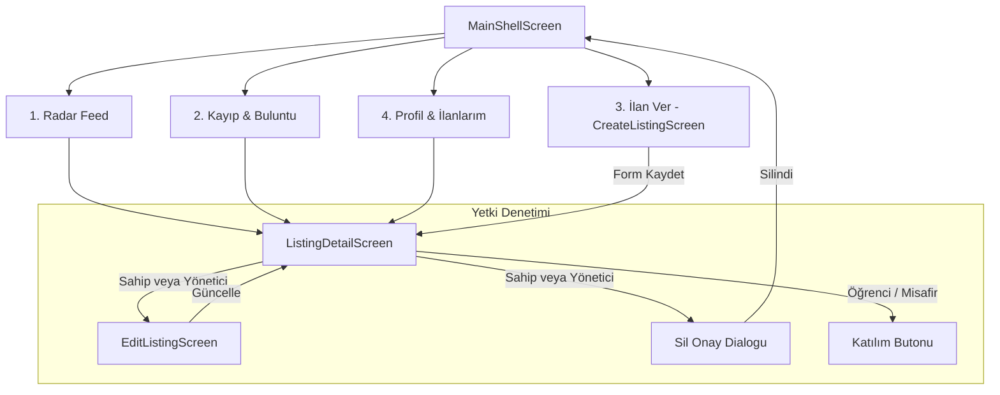

# Hafta 3 — İlan CRUD API, Form Doğrulamaları, Sahiplik ve İlan Sayfaları

Dönem projesi plan belgesindeki 3. Hafta hedefleri doğrultusunda, **fixCampus** mobil uygulamasında kampüs ilanlarının (Sosyal Radar ve Kayıp-Buluntu) uçtan uca yönetimi tamamlanmış; İlan Ekleme, İlan Detayı, İlan Düzenleme ve Silme onay akışları geliştirilerek iş kuralları ve sahiplik kontrolleri devreye alınmıştır.

---

## 1. Görev Paylaşımı ve Sorumluluklar

| Üye | Rol & Sorumluluk | Yapılan Çalışmalar |
| :--- | :--- | :--- |
| **Berke Mahmut Acar** | **İlan Sayfaları & Form Yönetimi** | `CreateListingScreen` (yeni ilan verme formu), `ListingDetailScreen` (zengin ilan detay görünümü), `EditListingScreen` (ilan güncelleme ekranı), silme onay iletişim kutusu (`AlertDialog`), DatePicker ve TimePicker ile etkileşimli buluşma tarihi/saati seçimi, `AppRoutes.editListing` rotası ve Material 3 temasıyla uyumlu görsel akışlar. |
| **Berna Kalkan** | **CRUD REST API & Servis Entegrasyonu** | `ListingService` ve `ApiListingService` servis katmanı (`GET /api/ilanlar`, `GET /api/ilanlar/{id}`, `POST /api/ilanlar`, `PUT /api/ilanlar/{id}`, `DELETE /api/ilanlar/{id}`, `GET /api/kategoriler`), `ApiClient` ile JWT Bearer token aktarımı ve `ListingsProvider` CRUD durum yönetimi. |
| **Zülfikar Durak** (Lider) | **Doğrulama Kuralları ve Sahiplik Denetimi** | `ListingValidator` kuralları: Başlık (3-150 karakter), Açıklama (5-3000 karakter), Yer (2-200 karakter); Sosyal buluşma için zorunlu gelecek tarih (UTC) ve Kayıp/Buluntu için null kontrolü; kategori-tür eşleşme doğrulaması; ilanın yalnızca sahibi veya yönetici tarafından düzenlenebilmesini/silinebilmesini sağlayan yetki denetimi. |

---

## 2. Geliştirilen Ekranlar ve Akış Detayları

### 2.1. İlan Verme Formu (`lib/screens/listings/create_listing_screen.dart`)
* **Dinamik Tür ve Kategori Seçimi:** Sosyal, Kayıp ve Buluntu butonları ile tür seçimi yapılır. Seçilen türe göre kategoriler anında filtrelenir; tür değiştiğinde kategori seçimi otomatik sıfırlanır.
* **Tarih & Saat Seçimi:** Tür `Sosyal` olduğunda etkileşimli `showDatePicker` ve `showTimePicker` devreye girer. Geçmiş tarihler engellenir; seçilen tarih formatlı (`dd.MM.yyyy, HH:mm`) gösterilir. `Kayıp` veya `Buluntu` seçildiğinde tarih alanı gizlenir ve `null` olarak işlenir.
* **Form Doğrulaması:** Başlık (3-150), Konum (2-200) ve Açıklama (5-3000) alanları `ListingValidator` ile denetlenir. Hatalı veya boş alanlarda kullanıcıya anında geri bildirim verilir.
* **Gönderim & Bildirim:** İstek sırasında buton üzerinde yükleniyor göstergesi belirir; işlem tamamlandığında form temizlenir ve kullanıcıya başarı bildirimi (`SnackBar`) gösterilir.

### 2.2. İlan Detay Görünümü (`lib/screens/listings/listing_detail_screen.dart`)
* **Kapsamlı Bilgi Görünümü:** İlan başlığı, tür rozeti, durum rozeti, kategori etiketi, konum bilgisi (`Icons.location_on_outlined`), buluşma zamanı (sosyal ise) ve detaylı açıklama.
* **Sahiplik Eylem Çubuğu:** Yalnızca oturum açmış kullanıcı **ilanın sahibi** ise veya **Yönetici** rolündeyse üst çubukta ve detay kartında "Düzenle" ve "Sil" butonları gösterilir. Diğer kullanıcılarda bu butonlar gizlenir.
* **Güvenli Silme Onayı (`AlertDialog`):** İlanı silme işleminde kullanıcıdan onay istenir ("Bu ilanı silmek istediğinize emin misiniz?"). Onay verildiğinde ilan ve ilana bağlı katılımlar temizlenir, ekran kapatılır.
* **Katılım ve Durum Butonları:** Sosyal ilanlarda diğer öğrenciler için "Buluşmaya Katıl" / "Katıldın" toggle butonu; kayıp-buluntu ilanlarında ilan sahibi için "Çözüldü Olarak İşaretle" eylemi.

### 2.3. İlan Düzenleme Ekranı (`lib/screens/listings/edit_listing_screen.dart`)
* **Mevcut Verilerle Başlatma:** İlanın başlık, yer, kategori, tarih ve açıklama bilgileri form alanlarına otomatik doldurulur.
* **Yetki Güvencesi:** Ekran açıldığında sahiplik ve yönetici yetkisi doğrulanır; yetkisiz erişim denemelerinde "Yetkisiz Erişim" uyarı ekranı sunulur.
* **Güncelleme & Senkronizasyon:** Kaydetme işlemi sonrasında hem `ListingsProvider` durum katmanı hem de detay/akış ekranları güncellenir.

---

## 3. Ekran ve Navigasyon Akış Şeması

---

## 4. Doğrulama ve Test Sonuçları

* **Kod Analizi (`flutter analyze`):** 0 hata ve 0 uyarı ile tamamlandı.
* **Model Doğrulaması (`dart run tool/verify_models.dart`):** 6 modelin JSON gidiş-dönüş, UTC dönüşümü ve kısıt testleri başarıyla geçti.
* **Test Süiti (`flutter test`):**
  * `test/listing_validator_test.dart`: 6 yeni alan doğrulama ve sahiplik testi.
  * `test/listing_service_test.dart`: 6 yeni CRUD API ve uç nokta testi.
  * `test/providers_test.dart`: 3 yeni CRUD durum yönetimi testi.
  * `test/listings_screens_test.dart`: 8 yeni ilan ekranları widget testi.
  * **Toplam:** **106 testin tamamı başarıyla geçti.**
